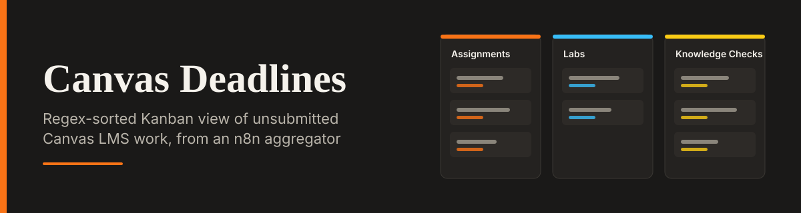

<div align="center">




</div>

# Canvas Deadlines - LMS Aggregator Dashboard

A premium B2B Kanban dashboard that acts as the UI layer for an n8n Canvas LMS automation. It visualizes the logic of **Workflow 8 (Canvas Deadline Aggregator)** by sorting unsubmitted work into regex-based buckets: Assignments, Labs, and Knowledge Checks.

**Live Demo:** [canvas-deadlines.lovable.app](https://canvas-deadlines.lovable.app)

## The Problem

Students juggle multiple courses and several kinds of work at once. A flat list of unsubmitted items is hard to prioritize, because a quick quiz and a long lab sit side by side with nothing to tell them apart.

This dashboard groups work by type, matched with regex on the item title, so it is clear at a glance what needs attention and in which category.

## n8n Workflow Reference

This UI is designed to accompany a self-hosted n8n automation. You can view the actual workflow code and documentation in my platform integration portfolio:

- **Repository:** [platform-integration-portfolio](https://github.com/Xhenzouu/platform-integration-portfolio)
- **Workflow Documentation:** [Workflow 8: Canvas Deadline Aggregator](https://github.com/Xhenzouu/platform-integration-portfolio/blob/main/docs/workflows/08-canvas-deadline-aggregator.md)
- **Raw Workflow JSON:** [canvas-deadline-aggregator.json](https://github.com/Xhenzouu/platform-integration-portfolio/blob/main/workflows/canvas-deadline-aggregator.json)

The n8n workflow handles the following logic:

1. Fetches all active Canvas courses and their paginated assignments.
2. Categorizes items using regex (for example `/-Lab/` for Labs and `/^KC -/` for Knowledge Checks).
3. Posts a daily grouped Slack digest of unsubmitted work.
4. Logs every run to Supabase with course and item counts.

This dashboard visualizes that flow: the Kanban columns mirror the regex buckets, and the "Sync Canvas" button simulates the daily fetch.

## Features

- **Kanban Board:** Three columns (Assignments, Labs, Knowledge Checks) matching the regex categorization used by the backend workflow.
- **KPI Header:** Instant visibility into Total Assignments, Unsubmitted, and the Last Synced timestamp.
- **Interactive Sync:** Clicking "Sync Canvas" simulates a new fetch, animating a new card into the board and incrementing the KPIs.
- **Dual Themes:** Full Light and Dark mode support.
- **Collapsible Sidebar:** A custom vertical-stacking layout for the logo and chevron when collapsed.

## Run Locally

1. Clone the repo:

   ```bash
   git clone https://github.com/Xhenzouu/canvas-deadlines.git
   cd canvas-deadlines
   ```

2. Install dependencies:

   ```bash
   npm install
   ```

3. Start the development server:

   ```bash
   npm run dev
   ```
